# Learning guide: the owner approves a booking request

**Purpose:** follow one feature end to end, owner's tap to database and back, for a developer who knows Laravel and Vue but is new to Next.js, React Server Components and Prisma.
**Read when:** you are new to this codebase, or you must change anything on the booking request path (request, approve, reject, locks, the exclusion constraint).
**Last verified:** `7b1ade5` (main). Every `file:line` below was read at that commit. Tests were read, not run, for this guide.

How to read the references: `path:12` is line 12, `path:12-20` a range. **UNVERIFIED** marks a claim not traced in code.

Files this guide covers:

| # | File | Role |
|---|---|---|
| 1 | `src/app/(public)/request-slot.ts` | Prologue: the public Server Action |
| 2 | `src/modules/booking/application/request-public-slot.ts` | Prologue: the public use case |
| 3 | `src/modules/booking/infrastructure/bookings/create.ts` | Prologue: the raw INSERT of a booking |
| 4 | `src/app/owner/(app)/requests/page.tsx` | The Requests page (Server Component) |
| 5 | `src/app/owner/(app)/requests/_components/inbox.tsx` | Loads the queue and the notify rows |
| 6 | `src/app/owner/(app)/requests/_components/pending-list.tsx` | Renders the Approve form |
| 7 | `src/components/ui/submit-button.tsx` | Client: disables the button while the action runs |
| 8 | `src/app/owner/(app)/today/actions.ts` | The Server Action `submitApproveBooking` |
| 9 | `src/modules/booking/schemas/booking-decision.ts` | Zod: the form shape |
| 10 | `src/lib/form-query.ts` | `field()` and `redirectOwner()` |
| 11 | `src/lib/use-case-error.ts` | Error → key mapping |
| 12 | `src/lib/errors.ts` | `DomainError` |
| 13 | `src/modules/booking/application/approve-booking.ts` | The use case |
| 14 | `src/modules/access/domain/can.ts` | The permission check |
| 15 | `src/modules/access/application/get-current-membership.ts` | Cookie → session → membership |
| 16 | `src/lib/tenant-context.ts` | Host → tenant, AsyncLocalStorage |
| 17 | `src/lib/db.ts` | The tenant-scoped Prisma client |
| 18 | `src/proxy.ts` and `src/lib/tenant-slug.ts` | Host check before any page runs |
| 19 | `src/modules/booking/infrastructure/bookings/locks.ts` | Row locks |
| 20 | `src/modules/booking/infrastructure/bookings/single.ts`, `status.ts`, `ranges.ts`, `pending.ts`, `interests.ts` | The queries |
| 21 | `src/modules/booking/domain/offered-slot.ts` | Pure rules: is this a real, free, future slot |
| 22 | `src/modules/booking/application/reject-overlapping-pending.ts` | Auto-reject the losers |
| 23 | `src/modules/booking/domain/exclusion.ts` | Recognise Postgres error 23P01 |
| 24 | `src/prisma/migrations/20260909080800_booking_approved_exclusion/migration.sql` and `src/prisma/schema.prisma` | The constraint and the tables |
| 25 | `src/components/ui/flash-toast.tsx` and `src/lib/copy/errors.ts` | How an error reaches the owner's screen |

Touched but not traced line by line (claims about them are marked UNVERIFIED): `src/modules/venue/infrastructure/pitches.ts` (`findPitchById`), `src/modules/venue/domain/schedule-config.ts`, `src/modules/venue/domain/availability.ts`, `src/lib/logger.ts`, `src/modules/booking/application/load-decision-notify.ts`, `src/modules/booking/ui/decision-notify.tsx`.

---

## 1. The feature in one paragraph

A player opens the stadium's public page, picks a free hour, and sends their name and phone. That creates a **PENDING** booking. The owner opens the **Requests** tab and sees the request with an **Approve** button (`pending-list.tsx:181-188`). One tap turns it **APPROVED**. In the same database transaction, every other PENDING request on the same pitch and overlapping time becomes **REJECTED**. Each of those people is saved as a "slot interest" (a waitlist row), so the owner can tell them later if the hour frees up (`reject-overlapping-pending.ts:38-76`). The page then reloads with a WhatsApp sheet listing who to tell (`actions.ts:66-70`, `inbox.tsx:62-86`). What can go wrong: the user may not have permission. Another tab or owner may already have decided the request. The hour may be taken or already started. The stadium may be suspended. Each case ends as a short, translated toast, never a crash (section 8).

---

## 2. Laravel to Next.js map (this feature's real files)

| Laravel concept | File here | How it differs |
|---|---|---|
| Route + controller | `src/app/owner/(app)/requests/page.tsx` (GET), `src/app/owner/(app)/today/actions.ts:47` `submitApproveBooking` (POST) | No routes file. The folder path is the URL. The POST handler is a **Server Action**: a function marked `"use server"` (`actions.ts:1`) that a `<form action={fn}>` calls directly. |
| FormRequest / validation | `src/modules/booking/schemas/booking-decision.ts:10-12` | A Zod schema, called by hand in the action (`actions.ts:52`). `z.strictObject` rejects extra keys. There is no automatic 422. A `ZodError` becomes the key `form.invalid` (`use-case-error.ts:31`). |
| Service class | `src/modules/booking/application/approve-booking.ts:54` | A plain exported async function ("use case"), not a class. There is no container and no dependency injection. The `deps` argument (`:33-47`) is a test seam. |
| Eloquent model | `src/prisma/schema.prisma:97-128` (`Booking`) | Prisma models are data shapes, not active records. There is no `$booking->save()`. Queries live in repository functions (`infrastructure/bookings/*.ts`). `during` is `Unsupported("tstzrange")` (`schema.prisma:102`), so most booking SQL here is raw. |
| `DB::transaction` | `approve-booking.ts:67` `db.$transaction(async (tx) => …)` | An "interactive transaction". Every query must use `tx`, not `db`, or it escapes the transaction (DR-001 §5). `db.ts:172-177` wraps it to load the tenant before `BEGIN`. |
| Policy / Gate | `src/modules/access/domain/can.ts:46-60` | A pure function `can(membership, permission)`. It is called inside the use case (`approve-booking.ts:58-61`), not by middleware. The page only hides the button (`pending-list.tsx:71,181`). |
| Middleware | `src/proxy.ts:41-53` | Next 16 calls middleware "proxy". It checks the host and strips spoofable headers. It does **not** load the tenant or the user. That happens in app code (`tenant-context.ts`), because the proxy cannot share memory with the page. |
| Global scope (multi-tenant) | `src/lib/db.ts:60-168` | A Prisma Client extension adds `tenantId` to every model query. It does **not** cover raw SQL, so raw SQL adds `tenantId` by hand (`locks.ts:21-25`). |
| Blade view | `src/app/owner/(app)/requests/_components/pending-list.tsx` | A **Server Component**: an `async` React function that runs on the server, may `await` data, and sends HTML. It ships no JavaScript of its own. |
| Vue component | `src/components/ui/submit-button.tsx` | A **Client Component** (`"use client"`, `submit-button.tsx:1`). It hydrates in the browser and uses the hook `useFormStatus` (`:17`) to disable itself while the action runs. |
| Events / notifications | `src/app/(public)/request-slot.ts:35` `after(alertOwnersOfNewRequest)`, and for approve the WhatsApp sheet built by `loadDecisionNotify` (`inbox.tsx:62-70`) | No queue and no listeners. On request, `after()` runs the owner push once the response is sent. On approve, nothing is sent by the server: the owner taps `wa.me` links in a sheet. The sheet's internals are UNVERIFIED. |
| Feature tests | `test/modules/booking/application/approve-booking.integration.test.ts`, `test/integration/pending-races.integration.test.ts` | Jest against a real Postgres. There is no HTTP client: tests call the use case directly, after stubbing the Host header and session cookie (`approve-booking.integration.test.ts:102-103`). |

---

## 3. The request, step by step

**Step 0 (server): the page renders the button.** `page.tsx:12-39` is an async Server Component. It awaits `searchParams`, `requireOwnerMembership()` and the locale, then renders `RequestsInbox` inside `<Suspense>`. `inbox.tsx:44-48` loads pending requests, the waitlist and a hidden count in parallel. `pending-list.tsx:183-188` renders a plain HTML form:

```tsx
<form action={submitApproveBooking} className="min-w-0">
  <input type="hidden" name="bookingId" value={item.request.id} />
  <SubmitButton className="w-full">
```

Why on the server: the list needs the database, and the owner gets HTML at once. `submitApproveBooking` is a server function. React turns it into an action reference in the HTML, so the browser never receives its code.

**Step 1 (browser): the tap.** `SubmitButton` is the only client code on this path. While the action runs, `useFormStatus()` reports `pending`, and the button shows "…" and is disabled (`submit-button.tsx:17-22`). This stops a double tap in one tab. It does not stop two tabs (section 7).

**Step 2 (server): the proxy.** Before any action or page, `proxy.ts:42-43` returns 404 if the host is not the base domain or a one-label subdomain of it. `proxy.ts:53` deletes any client-sent `x-tenant-slug`.

**Step 3 (server): the Server Action.** `actions.ts:47-71`. It reads the field with `field()` (`form-query.ts:3-6`), validates with Zod (`:52-54`), and calls the use case (`:56-58`). `allowStarted` is only `"1"` from the "They played" form (`pending-list.tsx:322`). Errors become a key (`:61`). `redirect()` is called **outside** `try/catch` (`:63-70`), because `redirect` works by throwing.

**Step 4 (server): authorize, before the transaction.** `approve-booking.ts:58-61`:

```ts
const membership = await getCurrentMembership();
if (!membership || !can(membership, BOOKINGS_APPROVE)) {
  throw new DomainError("access.not_allowed");
}
```

`getCurrentMembership` (`get-current-membership.ts:25-54`) returns null for a suspended stadium (`:29`), a missing or expired cookie (`:31-38`), or a user with no membership on **this** host's tenant (`:43-44`). It is wrapped in React `cache()`, so the layout and page share one lookup per request (`:23`).

**Step 5 (server): the transaction.** `approve-booking.ts:67-118`, in order:

1. Read the booking without a lock, only to learn its pitch (`:68`).
2. Lock the pitch row: `SELECT … FOR UPDATE` (`:72`, `locks.ts:17-30`).
3. Read the booking again, now under the lock, and require `PENDING` (`:73-79`). Another transaction may have changed it while we waited.
4. Load the pitch and its schedule (`:81-85`). Load the APPROVED ranges on that pitch (`:86`, `ranges.ts:23-52`).
5. Check the slot is real, free and in the future: `resolveOfferedSlot` (`:87-96`, `offered-slot.ts:21-64`). This is pure code, with no database.
6. Find overlapping PENDING siblings and lock this request and all siblings in id order (`:101-105`, `locks.ts:65-80`). If ours is no longer PENDING, stop (`:106-108`).
7. Set ours to APPROVED (`:110`, `status.ts:11-23`).
8. Reject the siblings, add a slot interest for each, and collect their names (`:112-117`, `reject-overlapping-pending.ts:45-76`).

**Step 6 (server): after commit.** It logs (`approve-booking.ts:120-123`) and returns the auto-rejected people. A Postgres exclusion error becomes `booking.slot_unavailable` (`:126-131`). Any other non-domain error is logged and wrapped (`:133`, `use-case-error.ts:10-20`).

**Step 7 (server): the redirect.** `actions.ts:66-70` redirects to `/owner/requests?notify=approved&bookingId=…&siblings=…`. The person ids travel in the URL. `inbox.tsx:118-130` re-validates them (id shape, at most 20).

**Step 8 (server, then browser): the screen updates.** The redirect renders the Requests page again on the server. The approved request is gone from the PENDING list. `loadDecisionNotify` builds the WhatsApp rows (`inbox.tsx:62-70`), and the client `DecisionNotifySheet` opens with them (`inbox.tsx:74-86`). On error, the URL carries `?error=<key>`. `FlashToast`, a client component mounted in the owner layout (`src/app/owner/(app)/layout.tsx:54`), shows `toast.error(errorMessage(key))` and removes the key from the URL (`flash-toast.tsx:23-43`).

---

## 4. Server Components vs Client Components here

| File | Side | Why |
|---|---|---|
| `requests/page.tsx` | Server | Reads the session and search params; no interactivity. |
| `requests/_components/inbox.tsx` | Server | Calls application use cases (database). |
| `requests/_components/pending-list.tsx` | Server | Builds the list. Imports the Server Action and passes it to `<form action>`. |
| `components/ui/submit-button.tsx` | Client (`"use client"`, `:1`) | Needs `useFormStatus`, a browser hook. |
| `modules/booking/ui/reject-sheet.tsx` | Client (`"use client"`, `:1`) | A sheet with `useState`, used by the Reject button next to Approve. |
| `modules/booking/ui/decision-notify.tsx` | Client (`"use client"`, `:1`) | The WhatsApp sheet after approve. |
| `components/ui/flash-toast.tsx` | Client (`"use client"`, `:1`) | Reads the URL with `useSearchParams` and calls `router.replace`. |
| `app/owner/(app)/today/actions.ts` | Server only (`"use server"`, `:1`) | Not a component: the endpoint the form posts to. |

How data and actions reach client code: as **props**. A module `ui/` file may not import application code, infrastructure, the database or `@/app` (rule 6, `test/architecture/rules.ts:81-83`: "A Server Action is a prop typed in the ui file; the page passes it."). See it on the line next to Approve:

```tsx
<RejectRequestButton submitRejectBooking={submitRejectBooking}
  bookingId={item.request.id}
```

(`pending-list.tsx:189-190`.) The server file imports the action from `actions.ts` (`:24-28,42`) and hands it down. The client component receives a callable reference, not the code. Approve itself needs no client wrapper. The form lives in a Server Component, and only the button inside it is client code. Data works the same way: `inbox.tsx:75-85` maps rows into plain objects before passing them to `DecisionNotifySheet`, because props that cross into a client component must be serialisable.

---

## 5. Tenant isolation on this path

**Host → tenant.** The proxy only rejects bad hosts (`proxy.ts:42-43`) and drops a client `x-tenant-slug` (`:53`). The tenant is resolved inside app code. `tenant-context.ts:50-85` `loadTenant` reads the Host via `resolveTenantFromHeaders(await headers())` (`:52`, `tenant-slug.ts:109-118`), loads the row with `platformDb` (`:58-61`), and calls `notFound()` for an unknown slug (`:63-65`). The Origin and Referer fallback runs only when `NODE_ENV !== "production"` (`tenant-slug.ts:66,98-104`). Note: DR-001 §2 describes the proxy setting a header that app code reads. The code has moved on: the header is deleted, and app code checks the host itself ("From the validated Host, never from a client header (security audit S-9)", `tenant-context.ts:51`).

**URL picks the tenant; the session only authorizes.** `getCurrentMembership` looks up the membership for the URL's tenant (`get-current-membership.ts:21-22,43`). A cookie for stadium A on stadium B's host gives `null`, so you get `access.not_allowed`.

**AsyncLocalStorage.** `db.$transaction` is wrapped so the tenant is loaded **before** `BEGIN` and kept in an `AsyncLocalStorage` (`db.ts:170-177`, `tenant-context.ts:132-137`). Inside the transaction, `getCurrentTenantId()` reads memory (`tenant-context.ts:108-114`). It does not open a second query on the pool, which would deadlock (`db.ts:55-58`). The test at `approve-booking.integration.test.ts:172-195` checks this: zero calls to `platformDb.tenant.findUnique` during approve.

**The Prisma extension.** For tenant models (`db.ts:8-29`), `updateMany` gets `where.tenantId` added (`db.ts:98-110`). So `setPendingStatus` (`status.ts:16-19`) is scoped without naming the tenant:

```ts
const result = await tx.booking.updateMany({
  where: { id: bookingId, status: "PENDING" },
  data: { status },
});
```

**Raw SQL stamps it by hand.** The extension does not see `$queryRaw` (`locks.ts:15`: "Raw SQL includes tenantId — the extension does not stamp $queryRaw."). Every raw query on this path does:

```ts
const tenantId = await getCurrentTenantId();
… WHERE id = ${pitchId} AND "tenantId" = ${tenantId} FOR UPDATE
```

(`locks.ts:21-25`; the same pattern is in `single.ts:25-37`, `ranges.ts:28-44`, `pending.ts:46-63`, `interests.ts:13-22`, `create.ts:33-44`.) The `${…}` values are bound parameters of a tagged template, not string concatenation, so this is not SQL injection.

**Suspension.** `getCurrentTenantId()` throws `tenant.suspended` for a suspended tenant (`tenant-context.ts:110-112`). This is the choke point for every scoped query and raw stamp (`:103-107`).

---

## 6. The database

Tables this feature reads or writes:

| Table | Read / write | Columns that matter |
|---|---|---|
| `Booking` | read, lock, update `status` | `id`; `tenantId`; `pitchId`; `during` (tstzrange); `status` (PENDING, APPROVED, REJECTED…); `priceUsd` (Decimal(12,2), a snapshot of the slot price); `amountDueUsd`; `requestedAt` (sorts the queue, `pending.ts:65`); `requestedName` (`schema.prisma:97-128`) |
| `BookingParticipant` | read (join) | `bookingId`, `personId`, `isRequester` (true for the person who asked), `amountDueUsd` (`schema.prisma:131-160`) |
| `Person` | read (join) | `id`, `name`, `phone` (shown in the queue and in the WhatsApp sheet) (`schema.prisma:73-94`) |
| `SlotInterest` | insert | `pitchId`, `during` (the **approved** window), `personId` (`schema.prisma:163-176`) |
| `Pitch` | lock (`FOR UPDATE`), read | `id`, `tenantId`, `scheduleConfig` (jsonb, Zod-parsed at `approve-booking.ts:85`) (`schema.prisma:53-70`) |
| `Tenant`, `Session`, `Membership` | read (before the transaction) | Tenant `slug`, `settings`, `suspendedAt` (`tenant-context.ts:58-61`); session and membership via the access repositories (UNVERIFIED: their exact columns were not traced) |

**The `during` column.** It is a Postgres `tstzrange`: one value holding start and end as UTC timestamps. It is written half-open `[start, end)`: `tstzrange(${input.start}, ${input.end}, '[)')` (`create.ts:45`, `interests.ts:20`). Half-open means an 18:00–19:00 game and a 19:00–20:00 game do not overlap. The domain mirrors this rule in `overlaps()` (`offered-slot.ts:66-71`). Prisma has no range type, so the column is `Unsupported("tstzrange")` (`schema.prisma:101-102`). It is read back with `lower(during)` and `upper(during)` (`single.ts:31-32`) and written with raw SQL. This is why the booking repositories are mostly raw SQL.

**The exclusion constraint.** The whole migration (`migration.sql:5-13`):

```sql
CREATE EXTENSION IF NOT EXISTS btree_gist;

ALTER TABLE "Booking"
  ADD CONSTRAINT "Booking_approved_during_excl"
  EXCLUDE USING gist (
    "pitchId" WITH =,
    "during" WITH &&
  )
  WHERE ("status" = 'APPROVED');
```

In words: no two rows may have the same `pitchId` **and** overlapping `during` (`&&`), counting only rows whose status is APPROVED. PENDING rows may overlap freely (DR-002 §2.8). `btree_gist` is needed so a GiST index can compare a text column with `=` (`migration.sql:3`). Prisma cannot express `EXCLUDE`, so it lives only in this hand-written migration. The constraint has no `tenantId`. That is safe because pitch ids are unique across all tenants (`@id @default(cuid())`, `schema.prisma:54`).

```mermaid
erDiagram
  Pitch ||--o{ Booking : "has"
  Pitch ||--o{ SlotInterest : "has"
  Booking ||--o{ BookingParticipant : "has"
  Person ||--o{ BookingParticipant : "is"
  Person ||--o{ SlotInterest : "waits"
  Pitch {
    string id PK
    string tenantId
    json scheduleConfig
  }
  Booking {
    string id PK
    string tenantId
    string pitchId FK
    tstzrange during "EXCLUDE pitchId =, during && WHERE APPROVED"
    enum status
    decimal priceUsd
    decimal amountDueUsd
    datetime requestedAt
  }
  BookingParticipant {
    string id PK
    string tenantId
    string bookingId FK
    string personId FK
    boolean isRequester
    decimal amountDueUsd
  }
  Person {
    string id PK
    string tenantId
    string name
    string phone
  }
  SlotInterest {
    string id PK
    string tenantId
    string pitchId FK
    tstzrange during
    string personId FK
  }
```



---

## 7. Concurrency

**The lock order is pitch first, then booking rows.** `locks.ts:1-3` states it, and `docs/ARCHITECTURE.md` §6 lists every use case. For approve: "P → B\* ({this request} ∪ overlapping pending, one statement, id order) → B\* again (subset, via `rejectOverlappingPending`)".

What each lock prevents:

- **The pitch lock** (`locks.ts:17-30`) serialises every writer that could create or approve a game on that pitch: approve, owner-create and the public request (`request-public-slot.ts:58`). A second transaction **waits** at that line until the first commits. It then re-reads with fresh data. That is why approve reads the booking a second time after the lock (`approve-booking.ts:73-79`).
- **The ordered row lock** (`locks.ts:65-80`, `ORDER BY id FOR UPDATE`) protects against paths that do **not** take the pitch lock. "Dismiss all missed" locks only booking rows (ARCHITECTURE.md §6: "No P."). If approve locked row 2 and then row 1 while dismiss locked 1 and then 2, each would wait for the other: a deadlock. Both now lock in id order, so that cannot happen (`locks.ts:59-64`; the comment at `approve-booking.ts:98-100`).

**Scenario A: two owners (or two tabs) approve overlapping requests R1 and R2 at once.** R1 and R2 overlap, so each is the other's sibling.

```mermaid
sequenceDiagram
  participant A as Owner A (approve R1)
  participant DB as Postgres
  participant B as Owner B (approve R2)
  A->>DB: BEGIN; SELECT Pitch FOR UPDATE
  B->>DB: BEGIN; SELECT Pitch FOR UPDATE
  Note over B,DB: B waits: A holds the pitch row
  A->>DB: re-read R1 (PENDING), check slot free
  A->>DB: lock R1,R2 ORDER BY id FOR UPDATE
  A->>DB: R1 to APPROVED, R2 to REJECTED, insert SlotInterest
  A->>DB: COMMIT
  DB-->>B: pitch lock granted
  B->>DB: re-read R2: status REJECTED
  B-->>B: throw booking.no_longer_pending; ROLLBACK
  Note over A,B: If any path skipped the locks, the second UPDATE to APPROVED<br/>would hit Booking_approved_during_excl (23P01) and map to booking.slot_unavailable
```

The same flow covers **two tabs on one request**. The second tab waits, re-reads, finds APPROVED, and gets `booking.no_longer_pending`.

**Scenario B: a public request arrives during an approve.** The request also takes the pitch lock first (`request-public-slot.ts:41-46,58`). If it gets the lock first, it inserts a PENDING row and commits. Approve then finds it as a sibling and rejects it with an interest. If approve gets the lock first, the request sees the approved range (`:87-88`). It saves an interest and fails with `booking.slot_taken` (`:89-100,125-131`). Either way, no PENDING row is stranded on an approved hour. `pending-races.integration.test.ts:50-74` asserts this ten times.

**Why the exclusion constraint is still needed.** The locks are a convention that every code path must follow. The constraint is enforced by the database for every writer: a future use case that forgets the lock, a manual SQL fix, or a bug in the soft check. The test at `approve-booking.integration.test.ts:132-170` proves it. It replaces `listApprovedRanges` with an empty list, so the soft check passes, and asserts that the `UPDATE` hits the constraint and becomes `booking.slot_unavailable`. DR-002 §2.8: "The database prevents the collision; application code handles the fallout."

Transaction isolation: `approve-booking.ts:67` passes no `isolationLevel`, so Postgres's default (Read Committed) applies unless the server is configured otherwise (UNVERIFIED: server configuration not checked). Under Read Committed, each statement after the lock wait sees the newly committed rows. The re-read relies on that.

---

## 8. Errors

| Cause | Where thrown | Key | What the owner sees (EN copy; AR is shown first by default) |
|---|---|---|---|
| Not signed in, no membership on this stadium, or STAFF without the flag | `approve-booking.ts:59-61` | `access.not_allowed` | Toast "You are not allowed to do that." (`errors.ts:148`). STAFF normally never see the button (`pending-list.tsx:181`). |
| Stadium suspended | `get-current-membership.ts:29` returns null, so `approve-booking.ts:60` throws | `access.not_allowed` | Same toast. Whether a suspended owner can reach the Requests page at all depends on `requireOwnerMembership` (UNVERIFIED). The `tenant.suspended` key ("This service is temporarily unavailable.", `errors.ts:150`) is thrown by `getCurrentTenantId` (`tenant-context.ts:110-112`), but approve stops before it is reached. |
| Booking gone, or on another stadium | `approve-booking.ts:69-76` | `booking.not_found` | "Booking not found." (`errors.ts:172`) |
| Already decided (other tab, other owner, a dismiss) | `approve-booking.ts:77-79` or `:106-108` | `booking.no_longer_pending` | "This hour was just booked" (`errors.ts:200`) |
| An APPROVED game already covers the hour (soft check) | `offered-slot.ts:51-53` | `booking.slot_taken` | "That hour is taken." (`errors.ts:209`) |
| Exclusion constraint fired (race past the soft check) | `approve-booking.ts:126-131` | `booking.slot_unavailable` | "The hour is no longer available." (`errors.ts:215`) |
| Slot already started, without "They played" | `offered-slot.ts:55-57` | `booking.slot_ended` | "That hour has ended." (`errors.ts:213`) |
| Hours changed so the slot is no longer offered | `offered-slot.ts:47-49` | `booking.slot_not_offered` | "That hour is not offered." (`errors.ts:208`) |
| Pitch missing | `locks.ts:27-29`, `approve-booking.ts:82-84` | `booking.pitch_not_found` | "Pitch not found." (`errors.ts:216`) |
| Bad form (blank id, extra keys) | `booking-decision.ts:17-19` | `form.invalid` | "Check the form and try again." (`errors.ts:143`) |
| Anything else (bug, database down) | `use-case-error.ts:15-19`, `:32-38` | `error.generic` | "Something went wrong. Try again." (`errors.ts:142`). The details go to the log, never to the URL. |

How it is shown: `actions.ts:61-65` redirects to `/owner/requests?error=<key>`. `flash-toast.tsx:35` shows `toast.error(errorMessage(error, locale))`. `errorMessage` falls back to the generic line for unknown keys (`errors.ts:250-256`). DR-004 describes an "inline banner". The code uses a toast. A note in a historical DR does not change the code.

---

## 9. The tests that prove it

None were run for this guide. The integration tests need Docker Postgres (`docs/guides/testing-jest.md`).

| Test | Setup | Asserts | Bug it would catch |
|---|---|---|---|
| `test/modules/booking/application/approve-booking.integration.test.ts:111-130` | Two PENDING requests on the same slot a week ahead | Winner APPROVED, loser REJECTED, one SlotInterest | Siblings not rejected; waitlist row missing |
| same file `:132-170` | Approve A; revive B to PENDING; inject `listApprovedRanges: async () => []` | `DomainError` key `booking.slot_unavailable`; A still APPROVED, B not APPROVED | Constraint missing, or 23P01 not recognised (raw 500 instead of a calm message) |
| same file `:172-195` | Spy on `platformDb.tenant.findUnique` | 0 calls during approve; under 5 s | A nested tenant lookup inside the transaction (deadlock or hang) |
| same file `:197-262` | Past and future PENDING requests | A plain approve of a past slot fails `booking.slot_ended`; with `allowStarted` it passes; dismiss leaves the future request | Approving games that already happened without "They played" |
| `test/integration/pending-races.integration.test.ts:50-74` | 10 runs of `Promise.allSettled([approve, publicRequest])` | No PENDING overlapping an APPROVED window; the late requester has exactly one interest | Public request not taking the pitch lock (audit §1.2) |
| same file `:76-92` | Request an already-approved hour twice | No PENDING; one interest, not two | Duplicate waitlist rows; PENDING on a taken hour |
| same file `:104-133` | 10 runs of `approve(allowStarted)` vs `dismissMissedRequests()` on 3 missed rows | No `P2034` (deadlock); no PENDING left; APPROVED only if approve won | Locking rows in different orders |
| `test/modules/booking/domain/exclusion.integration.test.ts:35-78` | Two overlapping APPROVED inserts; a `SELECT 1/0` | `isExclusionViolation` true for the real 23P01, false for other errors | Misreading a Prisma-wrapped error |
| `test/integration/staff-permissions.integration.test.ts:57-65` | STAFF with `{}`, then with `{"bookings.approve": true}` | First `access.not_allowed` with status still PENDING; then APPROVED | Staff approving by default (BR-97) |
| `test/modules/access/domain/can.test.ts:17-33` | Pure | OWNER yes; STAFF only when the flag is strictly `true` | `"true"` or `1` accepted as true |
| `test/modules/booking/domain/offered-slot.test.ts:36-247` | Pure | Closed day, not a slot, ended, started, taken, half-open adjacency, midnight crossing | Wrong slot rules without a database |

The architecture tests (`test/architecture/rules.ts`) are the other guard. They fail the build if a `ui/` file imports application code, or a module imports upward.

A gap: no test was found that runs approve on a suspended stadium. The suspension tests found are for the platform use cases (UNVERIFIED that none exists elsewhere).

---

## 10. Why it is built this way

- **One transaction, owned by the use case** (DR-001 §5). Approve, auto-reject and waitlist rows commit together or not at all. Repositories take `tx` (`status.ts:11-15`). The WhatsApp message is built after the redirect, outside the transaction (DR-001 §5: "transactions contain writes to your own database, nothing else").
- **The extension is the primary isolation guard; RLS is deferred** (DR-001 §3). Raw SQL must stamp the tenant by hand (`docs/KEY-FILES.md` §3: "Raw SQL is not covered by it, so raw statements must stamp `tenantId` themselves.").
- **The URL resolves the tenant, the session only authorizes** (DR-001 §2, CLAUDE.md non-negotiables).
- **The exclusion constraint is the double-booking guarantee** (DR-002 §2.8). PENDING may overlap (RULE-2). `docs/KEY-FILES.md` §8 lists the migration among the files that must never change without tests.
- **The booking holds no person; the requester is a participant with `isRequester`** (DR-002 §2.9-2.10). So the queue joins `BookingParticipant` and `Person` (`pending.ts:59-62`).
- **Slot interest stores the window, not the dead booking** (DR-002 §2.13). That is why `insertSlotInterest` is given the approved window (`reject-overlapping-pending.ts:63-68`).
- **`can()` is a pure function on a jsonb flag set; STAFF cannot approve by default** (DR-003 §5).
- **Domain errors carry keys; Server Actions never throw uncaught** (DR-004). That is the shape of `actions.ts:47-71` and `use-case-error.ts`.
- **All copy goes through keys, Arabic first** (DR-005). The error text is not written at the throw site.
- **Authorize before `$transaction`.** The session lives on `platformDb` (`approve-booking.ts:52`). A `platformDb` query inside an open interactive transaction can deadlock on one pool (`db.ts:55-58`, and `docs/guides/prisma-transaction-tenant-guard.md`).
- **Layers and imports** (`docs/ARCHITECTURE.md`, enforced by `test/architecture/rules.ts`). `domain/` (`offered-slot.ts`, `can.ts`, `exclusion.ts`) has no `await` and no database. Queries live only in `infrastructure/`.

---

## 11. Defend yourself: 12 hard questions

**1. What actually prevents a double booking?**
Two layers. First, the pitch lock (`locks.ts:17-30`) makes writers on one pitch take turns. The re-check under that lock (`approve-booking.ts:73-96`) turns most races into a calm `no_longer_pending` or `slot_taken`. Second, the exclusion constraint (`migration.sql:7-13`) refuses any second overlapping APPROVED row, whatever the code did. The first layer is for a good error message. The second is the guarantee.

**2. Why raw SQL instead of the ORM?**
Prisma 7 has no range type, so `during` is `Unsupported` and absent from the generated client (`schema.prisma:101-102`). Reading it needs `lower()`/`upper()`, and `FOR UPDATE` has no Prisma API. The cost is real: raw SQL bypasses the tenant extension. Each query stamps `tenantId` by hand (`locks.ts:21-25`), and one forgotten `AND "tenantId" = …` would leak across stadiums. RLS (DR-001 §3, deferred) would be the backstop against that mistake, and it does not exist yet.

**3. Why authorize before the transaction instead of inside it?**
The session and membership are read through `platformDb`, a separate client. A nested query on another connection while an interactive transaction holds one can hang the pool (`db.ts:55-58`). Authorizing first also means an unauthorized tap never opens a transaction or takes a lock. The trade-off is a small window: a permission revoked between the check and the commit is not seen. For a role flag, that is acceptable.

**4. What if two tabs click Approve on the same request?**
`useFormStatus` only guards one tab (`submit-button.tsx:17-20`). The second tab's transaction waits on the pitch lock, re-reads, finds APPROVED, and throws `booking.no_longer_pending` (`approve-booking.ts:73-79`). The owner sees "This hour was just booked". That is true but slightly misleading when they booked it themselves. There is no idempotency key; the status check plays that role.

**5. How do you know the tests test anything?**
They assert database state, not mocks: statuses and row counts read with `platformDb` (`approve-booking.integration.test.ts:67-79`). The 23P01 test forces the exact path the lock normally hides, through a seam (`:156-161`). An honest limit: the comment there says the local dev database is single-connection, so a true parallel race is not reproduced there. The race tests use `Promise.allSettled` on the Docker Postgres. Whether its pool really runs both transactions at once is UNVERIFIED. A mutation check (delete the pitch lock and watch `pending-races` fail) would prove more. I have not run one.

**6. Why lock the pitch row instead of the booking rows?**
The thing being protected is "this pitch at this time", and a new PENDING request has no row yet to lock. The pitch row is the one shared object every writer can agree on (ARCHITECTURE.md §6). The cost is lower throughput, since all bookings on one pitch are serialised. For one stadium's traffic that is negligible.

**7. Why read the booking twice?**
The first read (`approve-booking.ts:68`) only finds the pitch id, so we know what to lock. After waiting for the lock, the row may have changed, so it is read again (`:73`). Using the first read would approve a request that another owner had just rejected.

**8. Why does the extension not just handle raw SQL too?**
Prisma query extensions hook model operations; `$queryRaw` is a string with parameters, and parsing SQL to inject a predicate would be fragile. So the rule is a convention, checked by review and by the `KEY-FILES.md` list, not by code. Weakness: no automated test greps raw SQL for the tenant stamp (UNVERIFIED that none exists).

**9. Is `setPendingStatus` safe without a lock of its own?**
Its `UPDATE … WHERE status = 'PENDING'` takes the row lock implicitly, and a count other than 1 throws (`status.ts:16-22`). The row is already locked at that point by `lockPendingRowsInOrder` (`approve-booking.ts:102-105`). A mismatch throws `booking.not_found`, which is a slightly wrong message for "already decided", but it is reached only if the earlier checks were bypassed.

**10. Code written with AI: how do you know it is not plausible-looking nonsense?**
Judge it the same way as human code: by the guards that do not depend on the author. The exclusion constraint is enforced by Postgres. The architecture rules are checked by tests. The race tests assert the absence of a known failure (`P2034`, stranded PENDING). The code also carries history: the audit comments (`request-public-slot.ts:41-46`, `locks.ts:59-64`) record real bugs that were found and fixed. That shows it was reviewed and corrected, not written once. It does not prove it is bug-free. Treat any untested branch as unknown.

**11. What does approve cost as the data grows?**
`listOverlappingPending` loads **every** PENDING row of the tenant and filters in JavaScript (`reject-overlapping-pending.ts:26-35`; `pending.ts:63-65` has no pitch or time filter). Approve calls it twice (`approve-booking.ts:101` and inside `rejectOverlappingPending`, `:49`). With limits of 3 future PENDING per phone (`request-public-slot.ts:102-106`), this stays small. But it is the first query I would narrow, with `pitchId` and `during &&` in the SQL. `listApprovedRanges` is already bounded by time (`ranges.ts:18-21`).

**12. What would you change?**
(1) Filter overlapping PENDING rows in SQL, by pitch and range. (2) Add a test that runs approve on a suspended stadium. (3) Use a distinct key or message when the same user already approved the request. (4) Check for an existing interest before inserting one for each rejected sibling: `interests.ts:9-24` inserts without the `hasSlotInterest` check the public path uses (`request-public-slot.ts:96-98`), so a person might get duplicates (whether a unique index prevents that is UNVERIFIED). (5) Add RLS as the backstop for a forgotten tenant stamp (DR-001 §3).

---

## 12. Trace it yourself: 6 exercises

1. **Find where the stadium id is added to the SQL that locks the pitch.** Open `src/modules/booking/infrastructure/bookings/locks.ts`. Look in `lockPitchForUpdate` for the `WHERE` clause and where its value comes from.
2. **Find what happens to a hidden field called `tenant` sent with the approve form.** Open `src/modules/booking/schemas/booking-decision.ts`, then `src/app/owner/(app)/today/actions.ts`. Look at the object passed to `parseBookingDecision` and the schema type.
3. **Find why a STAFF user does not see the Approve button, and why hiding it is not the security.** Open `src/app/owner/(app)/requests/_components/pending-list.tsx`, then `src/modules/booking/application/approve-booking.ts`. Look for `mayDecide` and for `can(`.
4. **Find how a Postgres error code becomes the message "The hour is no longer available."** Open `src/modules/booking/domain/exclusion.ts`, `approve-booking.ts` (the `catch`), then `src/lib/copy/errors.ts`.
5. **Find why approving 19:00–20:00 does not reject a pending 20:00–21:00 request.** Open `src/modules/booking/domain/offered-slot.ts` and the `during` insert in `src/modules/booking/infrastructure/bookings/create.ts`.
6. **Find how the tenant id reaches the Prisma extension inside a transaction without a database call.** Open `src/lib/db.ts` (the end of the file), then `src/lib/tenant-context.ts` (`withCurrentTenant`, `getCurrentTenantId`).

### Answers

1. `locks.ts:21-25`: `const tenantId = await getCurrentTenantId();` then `WHERE id = ${pitchId} AND "tenantId" = ${tenantId} FOR UPDATE`. The value comes from the request's host, through tenant-context, never from the form.
2. It is never read. The action builds `{ bookingId: field(formData, "bookingId") }` only (`actions.ts:52-54`). Even if it were passed, `z.strictObject` would reject the extra key (`booking-decision.ts:7-12`). The comment at `form-query.ts:10` says it plainly: "Tenant is not in FormData — host/subdomain only."
3. `pending-list.tsx:71` computes `mayDecide = can(membership, BOOKINGS_APPROVE)` and renders the form only if true (`:181`). The real check is `approve-booking.ts:58-61`. A crafted POST without the button still reaches the use case and gets `access.not_allowed`.
4. `isExclusionViolation` walks the error and its `cause` chain for code `23P01` or the constraint name (`exclusion.ts:5-28`). `approve-booking.ts:126-131` maps it to `booking.slot_unavailable`. `errors.ts:215` holds the English line (the Arabic one is at `:93`).
5. `overlaps()` is strict on both sides: `a.start < b.end && a.end > b.start` (`offered-slot.ts:69-70`), so touching ends do not overlap. The database agrees, because the range is written `'[)'` (`create.ts:45`) and `&&` respects the open upper bound.
6. `db.ts:172-177` wraps `$transaction` in `withCurrentTenant`. That loads the tenant once and runs the callback inside `tenantAls.run(tenant, fn)` (`tenant-context.ts:132-137`). Inside, `getCurrentTenantId` reads `tenantAls.getStore()` first (`:109`), so there is no query.

---

## 13. Glossary

- **App Router**: Next.js routing where folders under `src/app/` are URLs and special files (`page.tsx`, `layout.tsx`) render them.
- **Route group `(app)`, `(public)`**: a folder in parentheses that groups routes without adding to the URL.
- **`_components` folder**: a private folder (leading underscore) that is never a route.
- **Server Component**: a React component that runs only on the server, may be `async`, and sends HTML; the default in the App Router.
- **Client Component**: a component in a file marked `"use client"`; it is also sent to the browser and can use state and hooks.
- **`"use client"` / `"use server"`**: directives at the top of a file; the first marks the client boundary, the second marks exported functions as Server Actions.
- **Server Action**: an async server function a form or client code can call like an endpoint; here `submitApproveBooking`.
- **`<form action={fn}>`**: React form that posts to a Server Action; works without client JavaScript.
- **`useFormStatus`**: React DOM hook giving `pending` for the enclosing form's submission.
- **Hydration**: the browser attaching React behaviour to server-sent HTML for client components.
- **Props serialisation**: values passed from a server to a client component must be serialisable (plain data, or a Server Action reference).
- **`redirect()`**: Next.js function that ends the action with a redirect by throwing a special error; keep it outside `try/catch`.
- **`searchParams`**: the URL query of a page, a Promise in Next 16 (`await searchParams`).
- **`useSearchParams` / `useRouter` / `router.replace`**: client hooks to read the query and change the URL without a full reload.
- **`<Suspense>`**: React boundary that shows a fallback while an async child loads.
- **`notFound()`**: Next.js function that renders the 404 page.
- **`headers()`**: Next.js server function returning the incoming request headers.
- **Proxy (`src/proxy.ts`)**: Next 16's name for middleware; runs before every request.
- **`after()`**: Next.js function that runs work after the response is sent.
- **React `cache()`**: memoises an async function for the duration of one server request.
- **AsyncLocalStorage (ALS)**: Node.js per-request storage that follows `await` chains; holds the tenant here.
- **Prisma Client**: the generated, typed database client.
- **Prisma Client extension (`$extends`)**: a hook around client operations; here it adds `tenantId`.
- **Interactive transaction (`$transaction(async tx => …)`)**: one database transaction across several awaited queries using the `tx` client.
- **`$queryRaw` / `$executeRaw`**: Prisma's raw SQL with tagged-template parameters (bound, not concatenated).
- **`Unsupported("tstzrange")`**: Prisma schema type for a column Prisma cannot read or write through the client.
- **`updateMany`**: Prisma update by filter that returns a count; used as a compare-and-set on `status`.
- **`P2034` / `P2025`**: Prisma error codes for a transaction conflict or deadlock, and for a record not found.
- **Zod / `z.strictObject`**: runtime schema validation; strict objects reject unknown keys.
- **`tstzrange`**: Postgres range of `timestamptz` values; `[)` means start included, end excluded.
- **`lower()` / `upper()`**: Postgres functions returning a range's start and end.
- **`&&`**: Postgres "ranges overlap" operator.
- **Exclusion constraint (`EXCLUDE USING gist`)**: Postgres rule that no two rows match all listed operators at once; a generalised unique constraint.
- **GiST / `btree_gist`**: index type that supports ranges; the extension adds `=` for scalar columns inside it.
- **Partial constraint (`WHERE …`)**: a constraint that applies only to rows matching the condition.
- **`23P01`**: Postgres SQLSTATE for an exclusion violation.
- **`SELECT … FOR UPDATE`**: locks the selected rows until the transaction ends; others wait.
- **Deadlock**: two transactions each waiting on a lock the other holds; Postgres kills one.
- **Read Committed**: Postgres default isolation; each statement sees data committed before it began.
- **jsonb**: Postgres binary JSON column (`scheduleConfig`, `permissions`).
- **Decimal(12,2)**: exact numeric type used for money; never a float.
- **cuid**: a collision-resistant string id generated by Prisma's `@default(cuid())`.
- **RLS (Row Level Security)**: Postgres per-row access policies; deferred here (DR-001 §3).
